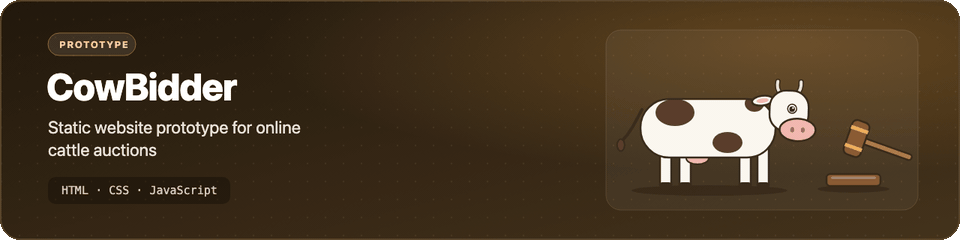

<p align="center">
  <picture>
    <source media="(prefers-reduced-motion: reduce) and (prefers-color-scheme: dark)" srcset="assets/banner-dark.svg">
    <source media="(prefers-reduced-motion: reduce)" srcset="assets/banner-light.svg">
    
  </picture>
</p>

<h1 align="center">CowBidder</h1>

<p align="center">A static landing-page mock-up for an online cattle auction, made as a test project for the 12 Breeders group in Thailand.</p>

<p align="center">
  
  
  
  
</p>

## What's inside

- 🧭 A fixed navigation bar with section links and a search box that slides open when the search icon is clicked (`js/main.js`).
- 🐄 A hero section and a gallery of six cattle photos with a zoom-on-hover effect.
- 📄 Placeholder "About Us", "What We Offer" and "Blog & News" sections (the copy is still lorem ipsum).
- 🎨 Plain CSS with a few colour variables, the Poppins font from Google Fonts and icons from [Boxicons](https://boxicons.com/).

It is a front-end mock-up only: there is no back end, no bidding logic and no real data.

## Getting started

No build step is needed. Serve the folder with any static file server, for example:

```bash
git clone https://github.com/Worakornk/CowBidder.git
cd CowBidder
python3 -m http.server 8000
```

Then open <http://localhost:8000>. Opening `index.html` directly in a browser also works.

## Project structure

```text
CowBidder/
├── index.html          # the whole page
├── css/
│   └── style.css
├── js/
│   └── main.js         # search box toggle
└── assets/
    └── images/         # cattle photos, hero background, about image
```

<details>
<summary>Known gaps</summary>

- The "What We Offer" and "Blog & News" cards point to images (`part1.png`–`part6.png`, `car1.jpg`–`car3.jpg`) that were never added to the repository, so those cards show no picture.
- The menu icon for small screens is in the markup but has no script yet.

</details>

## Credits

- Page layout and class names (`cars-container`, `parts-container`, "Auto Spare Parts" cards) follow a car-website HTML/CSS tutorial that was adapted for cattle; the original source has not been identified.
- Icons: [Boxicons](https://boxicons.com/) (MIT). Font: [Poppins](https://fonts.google.com/specimen/Poppins) (SIL Open Font License).

## License

No license has been chosen yet, so all rights are reserved by default.
